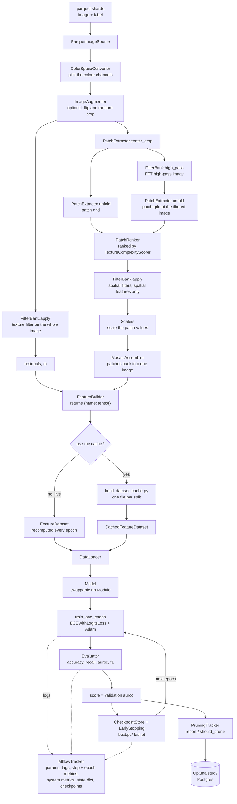
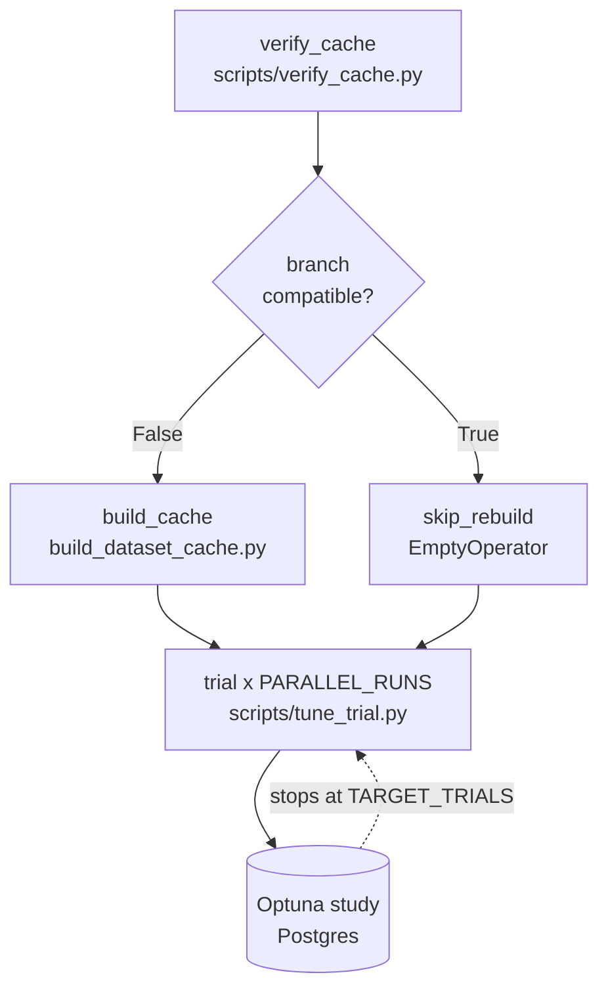

# AI image detection

Master's thesis repo — the training cycle is somewhat done.

Full training pipeline featuring patch-based noise extraction, with options for live preprocessing or cache generation.

## Pipeline overview



## Preprocessing pipeline

- `FeatureDataset` generates patch-based spatial and frequency noise features live.
- `CachedFeatureDataset` loads a contiguous-memory dataset cache generated by `build_cache(FeatureDataset)` to maximize training throughput. The cache can be saved as `torch.float16` (default 32) to save space.

## Training pipeline

- Generic `Trainer` with swappable components.
- Atomic checkpoints and early stopping.
- MLflow tracking with Databricks stores training, pipeline and system metrics.
- Critical sections of the pipeline are timed and logged.
- Seeds ensure reproducible runs.

## Hyperparameter search

- Uses Optuna to optimize parameter sampling and prune bad configurations early.
- Can be run as a single process or parallelized using Airflow.

## Design

Preprocessing and training components are modularized to be able to reuse and adapt the pipeline. Filters and feature scaling logic can also be easily swapped out by editing `configs/filters.py` or by defining custom functions for the Scaler in `pipeline/preprocessing.py`.

## Parallel tuning with Airflow

Optuna hyperparameter search is parallelized using Airflow DAGs. Only `training_parameters` and model parameters can be tuned, as optimization is done with cached data, which makes `preprocessing_parameters` fixed during a tuning run; they have to be manually tuned unless using `FeatureDataset` as a factory, which heavily slows tuning. Parallelization is done by launching multiple Docker containers and then executing the same study defined in `tune_trial`.



## Setup

```bash
uv python install 3.12
uv sync --all-extras          # or: uv sync --extra all
```

To verify that the live preprocessing + training pipeline works:

```bash
uv run scripts/test_pipeline.py
```

## MLflow tracking and Airflow parallelization

1. Set up the `.env` file in the repo root using the template, then test MLflow:

    ```bash
    uv run scripts/test_mlflow_databricks_tracking.py
    ```

2. Create the Airflow stack and the Python image:

    ```bash
    docker build -t ai-detection-tuner .
    docker compose up -d
    ```

    > **Note:** the project is bind-mounted into `ai-detection-tuner`, so file edits are picked up. Only changing Python dependencies requires rebuilding the image.

3. Open the Airflow UI at <http://localhost:8086/> and run the DAG `test_optuna_container`.

## Running a hyperparameter search

Default parameters live in `configs/`. Tune training and model parameters in `scripts/tune_trial.py`.

### Single process

1. Edit the default `processing_parameters` in `configs/pipeline_config.py`. These are fixed for a tuning run.
2. Build the cache:

    ```bash
    uv run scripts/build_dataset_cache.py
    ```

3. Use Optuna to tune model or training parameters in `scripts/tune_trial.py`.
4. Start tuning:

    ```bash
    uv run scripts/tune_trial.py
    ```

### Multi-process (Airflow)

1. Do steps 1 and 3 from the single-process list. Dag auto builds cache.
2. Set `PARALLEL_RUNS` in `dags/parallel_trials_dag.py`.
3. Open the Airflow UI at <http://localhost:8086/> and run the DAG `parallel_tuning`. The DAG also rebuilds the cache automatically if there is a config mismatch.

## Cache checks

`scripts/build_dataset_cache.py` and `scripts/verify_cache.py` check and build against the `processing_parameters` in `configs/pipeline_config.py`.

## Dataset

The dataset used in this pipeline should be stored in `./data`; it can be downloaded from <https://huggingface.co/datasets/Rajarshi-Roy-research/Defactify_Image_Dataset>.
